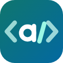

  

<h1 align="center">Fazlur Rahman (Alul)</h1>

Frontend Engineer · Jember, East Java, Indonesia

---

This is my personal portfolio. I build scalable, high-performance web products with Next.js and GraphQL, from the first commit to production.

The site gives a quick look at who I am, the products I've helped build, and how to reach me. It's available in English and Indonesian, in both light and dark mode.

## What's inside

- **About** — a short introduction and my background.
- **Skills** — the tools and technologies I work with every day.
- **Experience** — my journey at ICUBE, ICUBE by SIRCLO, and Barito Technologies Group.
- **Projects** — case studies of the products I've worked on, including the Belanjaku ecosystem, SwiftOMS, SWIFT Hub, WAVES-SSI, and KlikDiabetes.
- **Contact** — email, LinkedIn, GitHub, and my CV.

## Live site

TODO: add the link once the domain is ready.

## Get in touch

- Email: [alulfazlur@gmail.com](mailto:alulfazlur@gmail.com)
- LinkedIn: [linkedin.com/in/fazlur-alul-rahman](https://www.linkedin.com/in/fazlur-alul-rahman/)
- GitHub: [github.com/alulfazlur](https://github.com/alulfazlur)
