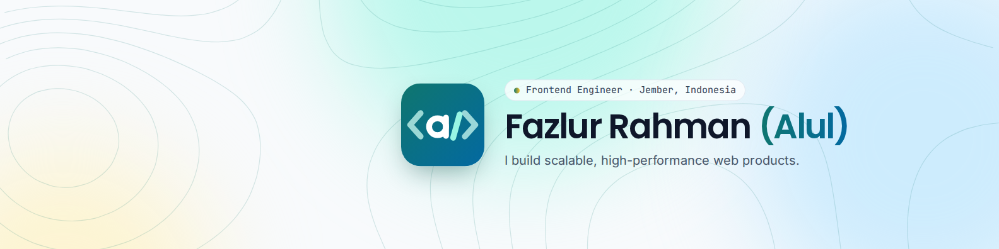
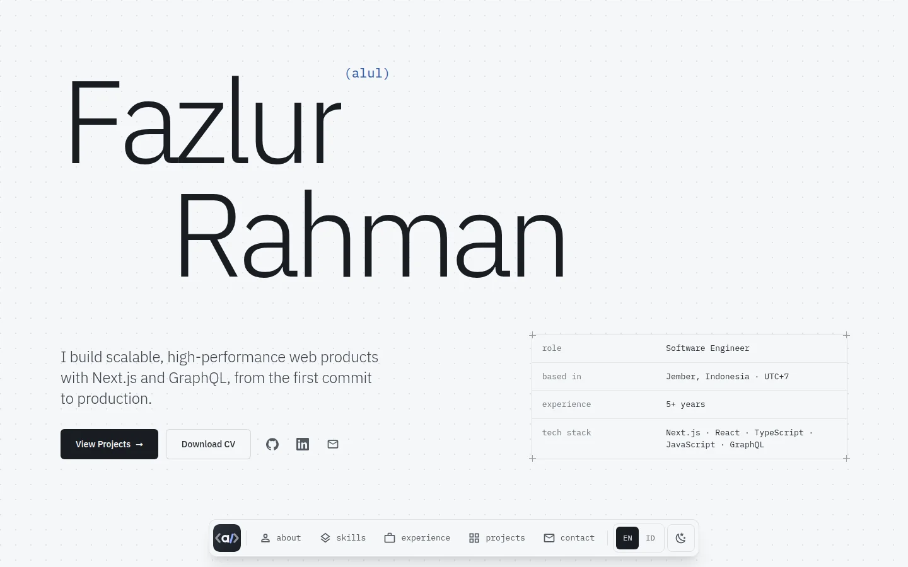
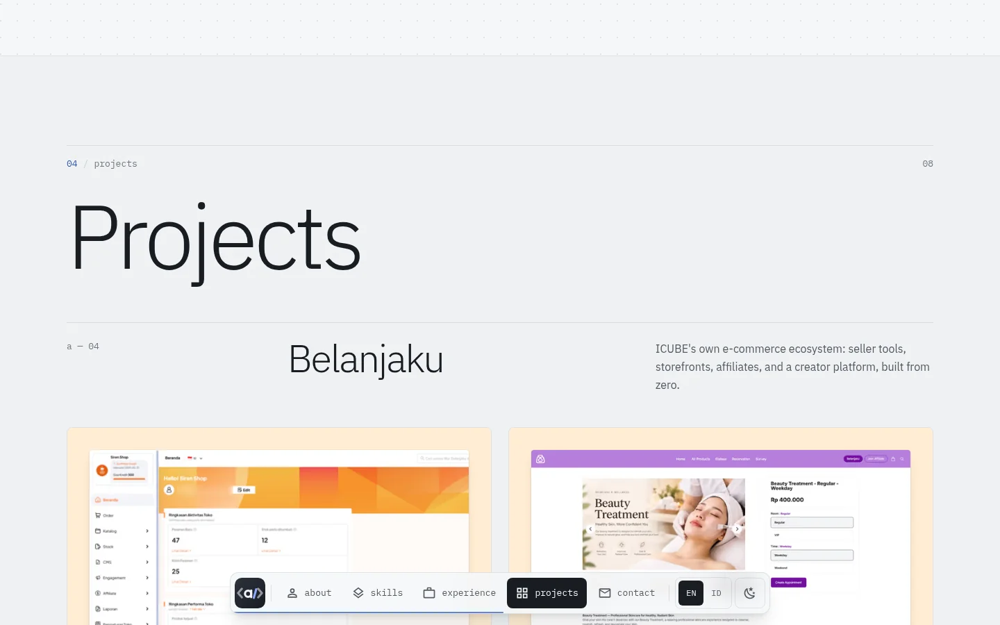
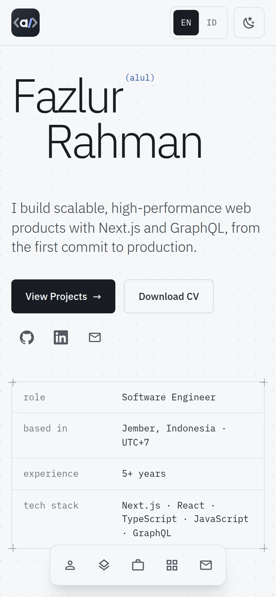
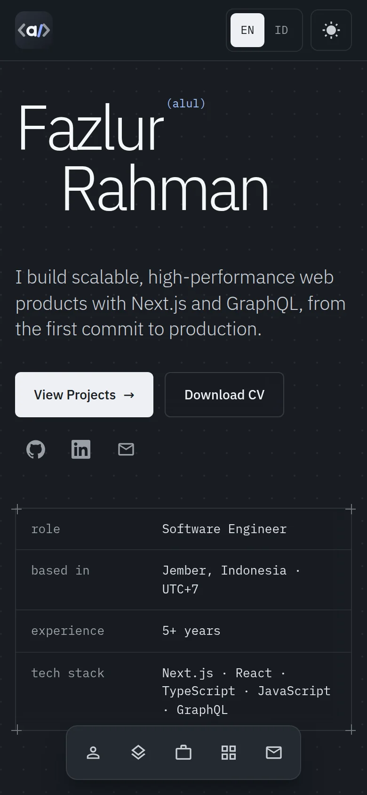

<a href="https://alul.vercel.app/">
  
</a>

<p align="center">
  <a href="https://alul.vercel.app/"><b>alul.vercel.app</b></a>
  &nbsp;·&nbsp;
  <a href="https://alul.vercel.app/doc/Fazlur%20Rahman%20Resume.pdf">CV</a>
  &nbsp;·&nbsp;
  <a href="https://www.linkedin.com/in/fazlur-alul-rahman/">LinkedIn</a>
  &nbsp;·&nbsp;
  <a href="mailto:alulfazlur@gmail.com">Email</a>
</p>

<p align="center">
  
  
  
  
  
  
</p>

---

Hi, I'm **Alul**, a software engineer from Indonesia with 5+ years of experience. I build scalable, high-performance web products with Next.js and GraphQL, from the first commit to production.

This repository is my portfolio: who I am, the products I've helped build, and how to reach me. It's in English and Indonesian, in light and dark mode.

<a href="https://alul.vercel.app/">
  <picture>
    <source media="(prefers-color-scheme: dark)" srcset=".github/readme/hero-dark.webp" />
    
  </picture>
</a>

## At a glance

| | |
| --- | --- |
| `role` | Software Engineer |
| `based in` | Jember, East Java, Indonesia · UTC+7 |
| `experience` | 5+ years: ICUBE, ICUBE by SIRCLO, Barito Technologies Group |
| `frontend` | Next.js · React · TypeScript · React Native · Tailwind CSS · Material-UI |
| `data` | GraphQL (Apollo) · Redux · REST APIs · react-hook-form · Yup |
| `backend` | PHP · Laravel · MySQL |
| `education` | S.Stat. (Statistics), Institut Teknologi Sepuluh Nopember |

## Selected work

Each project links to its case study: the problem, what I did, and the result.

| | Project | What it is |
| --- | --- | --- |
| **Belanjaku** | [Seller Dashboard](https://alul.vercel.app/en/projects/belanjaku-seller-dashboard) | Multi-tenant seller dashboard with a low-code page builder, built from zero to production. |
| | [Storefront](https://alul.vercel.app/en/projects/belanjaku-storefront) | The engine that turns builder pages into live, shoppable merchant sites. |
| | [Affiliate](https://alul.vercel.app/en/projects/belanjaku-affiliate) | Affiliate program dashboard with automated tracking and commission monitoring. |
| | [Creator](https://alul.vercel.app/en/projects/belanjaku-creator) | Where creators build templates and widgets, visually or in code, and sell them. |
| **SWIFT** | [SwiftOMS](https://alul.vercel.app/en/projects/swiftoms) | Omnichannel back office that syncs products, stock, and orders across marketplaces. |
| | [SWIFT Hub](https://alul.vercel.app/en/projects/swift-hub) | Multi-tenant seller hub on the SwiftOMS codebase for small businesses. |
| **Other** | [WAVES-SSI](https://alul.vercel.app/en/projects/waves-ssi) | Bilingual learning platform for a university research consortium (freelance). |
| | [KlikDiabetes](https://alul.vercel.app/en/projects/klikdiabetes) | React Native app for tracking activity, blood glucose, and medication. |

<p>
  
  
  
</p>

## Inside the site

The design direction is **"Spec Sheet"**: the page reads like calm technical documentation. Cool paper with a faint dot grid, graphite text, mono key/value tables, corner crosshairs, and one soft cobalt accent.

- **Card → modal morph.** A project card grows into its case study. It's a real URL (intercepting route in a `@modal` slot), so Back, Escape, and refresh all behave.
- **Bilingual, fully static.** Every page under `/en` and `/id` is prerendered. A small proxy sends `/` to the visitor's language.
- **Motion that stays out of the way.** The opening and hero entrance are pure CSS, so they run before hydration. The name drifts apart on scroll with a CSS scroll-driven animation. Everything respects `prefers-reduced-motion`.
- **Built to be found.** Per-page metadata, `hreflang` alternates, a sitemap, and generated Open Graph images for the home page and every project.
- **Accessible by default.** Semantic sections, keyboard navigation with visible focus rings, and 44px touch targets.

## Built with

| | |
| --- | --- |
| Framework | Next.js 16 (App Router, Turbopack), React 19, TypeScript (strict) |
| Styling | Tailwind CSS 4 (CSS-first `@theme`, oklch colors), IBM Plex Sans + Mono |
| Motion | [Motion](https://motion.dev/) with `LazyMotion`, CSS keyframes, and scroll-driven animations |
| Content | Typed TypeScript data + i18next (no CMS) |
| Icons | Material Design Icons, Simple Icons |
| Hosting | Vercel, with cookieless Vercel Web Analytics |

## Run it locally

Requires Node 24 (see `.nvmrc`) and Yarn 1.

```bash
yarn install
yarn dev        # http://localhost:3000
```

| Command | What it does |
| --- | --- |
| `yarn dev` | Dev server |
| `yarn build` | Production build |
| `yarn lint` | ESLint |
| `yarn typecheck` | `tsc --noEmit` |
| `yarn format` | Prettier |

All copy lives in [`src/content/locales`](src/content/locales) (`en.ts`, `id.ts`). Projects, experience, and skills are typed data in [`src/content`](src/content).

## Get in touch

I'm open to software engineering roles and freelance projects. Email is the fastest way to reach me.

- Email: [alulfazlur@gmail.com](mailto:alulfazlur@gmail.com)
- LinkedIn: [linkedin.com/in/fazlur-alul-rahman](https://www.linkedin.com/in/fazlur-alul-rahman/)
- GitHub: [github.com/alulfazlur](https://github.com/alulfazlur)
